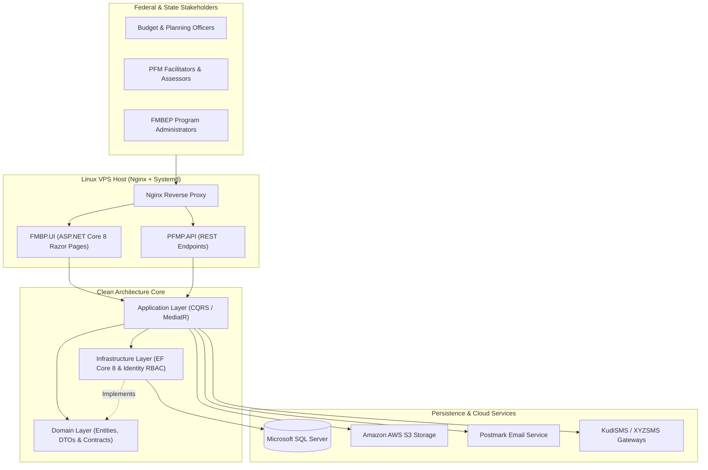

# PFMP — Federal Ministry of Budget & Economic Planning (FMBEP) Public Financial Management MIS

[](https://dotnet.microsoft.com/)
[](#system-architecture)
[](#technology-stack)
[](#technology-stack)
[](#ci-cd--security-posture)

An institutional **Public Financial Management, Capacity-Building, and Strategic Governance Platform (`PFMP` / `FMBP.UI`)** architected for the **Federal Ministry of Budget and Economic Planning (FMBEP), Nigeria** (Nutrition Public Financial Management initiative).

Engineered on **.NET 8 Clean Architecture and CQRS (`MediatR`)**, the platform coordinates inter-governmental fiscal management training, budget planning evaluations, multi-state stakeholder workflows, supervisory compliance reporting, and verifiable credentialing.

---

## Key Institutional Capabilities

- **Public Financial Management (PFM) Governance & Training**: Structured management of federal and state budget-planning cohorts, fiscal modules, facilitators, and institutional participants (`FMBP.UI`).
- **Pre-/Post-Assessment & Evaluation Matrix**: Quantitative measurement of PFM competency outcomes, daily session evaluations, and supervisory compliance audits.
- **Verifiable Digital Certification**: Automated generation of official completion credentials (`Certificate`, `ReadonlyPage`, `Rotativa.AspNetCore`) with tamper-evident verification.
- **Multi-Channel Institutional Alerts**: Integrated transactional email (**Postmark**) and SMS gateways (**KudiSMS** / **XYZSMS**) for participant onboarding and executive notifications.

---

## System Architecture



---

## Repository Structure

```text
PFMP/
├── .github/workflows/
│   └── deploy.yml                 # Automated Linux x64 self-contained CI/CD deployment
├── src/
│   ├── Domain/                    # Core domain entities, DTOs, and repository interfaces
│   ├── Application/               # CQRS Commands, Queries, and MediatR handlers
│   ├── Infrastructure/            # EF Core 8 DbContext, migrations, and SQL Server repositories
│   ├── API/                       # Companion REST Web API
│   ├── AWS/                       # Amazon S3 cloud storage service
│   └── PostmarkEmailService/      # Transactional email integration
├── XYZSMS/                        # SMS gateway client library
├── UI/
│   └── FMBP.UI/                   # Primary ASP.NET Core 8 Razor Pages portal (FMBEP Nutrition PFM)
│       └── .env.example           # Sanitized environment variable template
├── tests/
│   └── Test/                      # Unit & integration test suite
├── .env.example                   # Root environment variable template
├── deploy.sh                      # Systemd service orchestration, UFW port setup & HTTP health check
└── PFMP.sln                       # Visual Studio Solution
```

---

## Technology Stack

- **Framework**: C#, .NET 8, ASP.NET Core Razor Pages & Web API
- **Architecture**: Clean Architecture, CQRS (`MediatR`), Repository Pattern
- **Database**: Microsoft SQL Server, Entity Framework Core 8
- **Security**: ASP.NET Core Identity RBAC, Environment-Variable Secret Isolation (`DotEnv`, `chmod 600`)
- **Cloud & Messaging**: Amazon S3, Postmark Email API, KudiSMS / XYZSMS, `Rotativa.AspNetCore`
- **DevOps**: GitHub Actions CI/CD, Linux `systemd` (`pfmp.service`), Bash (`deploy.sh`), Nginx

---

## Local Development Setup

### 1. Clone & Configure Environment
```bash
git clone https://github.com/VS-GitHub-001/PFMP.git
cd PFMP
cp UI/FMBP.UI/.env.example UI/FMBP.UI/.env
```
Configure your local SQL Server connection string and API credentials inside `UI/FMBP.UI/.env`.

### 2. Build, Migrate & Launch
```bash
dotnet restore UI/FMBP.UI/FMBP.UI.csproj
dotnet build UI/FMBP.UI/FMBP.UI.csproj --configuration Release
dotnet ef database update --project src/Infrastructure --startup-project UI/FMBP.UI
dotnet run --project UI/FMBP.UI
```

---

## CI/CD & Security Posture

- **Strict Secret Separation**: Runtime secrets reside exclusively in `/var/www/pfmp/.env` (`chmod 600`) on the production host and are automatically preserved across releases by [`deploy.sh`](deploy.sh).
- **Automated Health Probes**: Every deployment verifies `systemd` active status and probes `http://127.0.0.1:$PORT/` before finalizing.

---

## Author

**Peter Emeka Onwuka**  
Chief Technology Officer & Enterprise Systems Architect  
- GitHub: [@SirP-TechHub-0904](https://github.com/SirP-TechHub-0904)  
- LinkedIn: [Peter Emeka Onwuka](https://www.linkedin.com/in/onwuka-peter-emeka)

